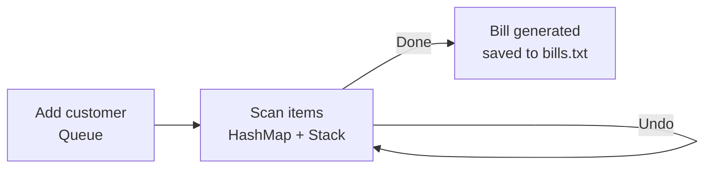

<div align="center">

# 🛒 Supermarket Billing System

**Queue · HashMap · Stack · Array · File Handling, all in one Java console app**


</div>

Customers join a billing queue, prices are looked up in a HashMap, and the last scanned item can be removed with a stack. Every bill is saved to `bills.txt`.

## 🧩 Data Structures

| | Structure | Role |
|:-:|---|---|
| 🚶 | **Queue** | Serves customers first come, first served |
| 🔑 | **HashMap** | Finds an item's price instantly |
| ↩️ | **Stack** | Undoes the last scanned item |
| 📋 | **Array** | Holds the product catalogue and menu |
| 💾 | **File handling** | Loads and saves bills in `bills.txt` |

**Prices:** Rice ₹60 · Milk ₹30 · Bread ₹40

## ✨ How it works



**Menu:** 1 Add customer · 2 Bill next customer · 3 View queue · 4 View saved bills · 5 Exit

While billing, type items like `Milk x2`, `Undo` to remove the last item, `Done` to finish. Billing is blocked when the queue is empty.

## 💻 Sample Run

```text
Name: Riya     →  Riya added to billing queue. Position: 1
Name: Aman     →  Aman added to billing queue. Position: 2

Billing: Riya
Item: Milk x2  →  Added Milk x2
Item: Bread x1 →  Added Bread x1
Item: Undo     →  Last item Bread removed.
Item: Done     →  Bill for Riya: Milk x2 = 60 | Total 60

View queue     →  1. Aman
```

## 🚀 Run

Requires JDK 11 or later.

```bash
javac -d build src/Main.java
cd build
java Main
```

## ✅ Test Cases

| # | Input | Output |
|:-:|---|---|
| 1 | Add customer `Riya` | `Riya added to billing queue. Position: 1` |
| 2 | Bill Riya: `Rice x1`, `Done` | `Bill for Riya: Rice x1 = 60 \| Total 60` · `Queue is now empty.` |
| 3 | Bill: `Chocolate` | `Item Chocolate not found in price list.` |
| 4 | Queue Riya, Aman. `Milk x2`, `Bread x1`, `Undo`, `Done`, view queue | `Last item Bread removed.` · `Bill for Riya: Milk x2 = 60 \| Total 60` · `1. Aman` |

## ⏱️ Time Complexity

| Operation | Time |
|---|:-:|
| Add customer (Queue) | O(1) |
| Price lookup (HashMap) | O(1) avg |
| Scan item / undo (Stack) | O(1) |
| Build bill | O(K) |
| View queue | O(C) |

*K = items in cart, C = customers waiting*

## 📁 Structure

```text
src/Main.java    Complete solution
tests/           Test inputs
docs/            Report and presentation
```
